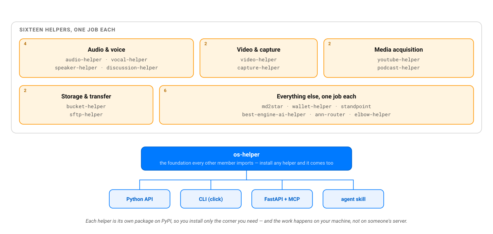

# AI Helpers

[🇫🇷](https://github.com/warith-harchaoui/ai-helpers/blob/main/LISEZMOI.md) · [🇬🇧](https://github.com/warith-harchaoui/ai-helpers/blob/main/README.md)

[](https://github.com/warith-harchaoui/ai-helpers)
[](LICENSE)
[](https://pypi.org/user/warith-harchaoui/)
[](https://crates.io/users/warith-harchaoui)

**AI Helpers réunit dix-sept bibliothèques Python. Chacune fait un seul travail d'intelligence artificielle ou de traitement des médias, sur votre propre machine.** L'une transcrit une réunion et dit qui a parlé quand. Une autre lit un texte à voix haute. Une troisième change un fichier Markdown en document Word. Vous n'ouvrez aucun compte. Rien ne part vers nos serveurs ; aucune mesure d'usage ne remonte chez nous. Six de ces bibliothèques existent aussi en Rust : elles tournent sur les téléphones et les petits boîtiers que Python n'atteint pas.

🌍 **Le site, la documentation et les questions fréquentes : [deraison.ai/ai-helpers](https://deraison.ai/ai-helpers/index.fr.php)**

⭐ **Si la suite a gagné sa place dans votre boîte à outils, mettez une étoile à ce dépôt.** Cela prend un clic et ne vous inscrit à aucune lettre d'information. Le prochain développeur qui arrive ici voit ainsi que le détour en vaut la peine. Une brique vous a sauvé un après-midi ? Son dépôt à elle mérite aussi une étoile.

---

## Que voulez-vous faire ?

| Vous voulez… | La brique qui le fait |
|---|---|
| transcrire une réunion en sachant qui a dit quoi, en direct ou après coup | [`vocal-helper`](https://github.com/warith-harchaoui/vocal-helper) |
| lire un texte à voix haute, prononcer une réponse au fur et à mesure qu'elle s'écrit, imiter une voix | [`speaker-helper`](https://github.com/warith-harchaoui/speaker-helper) |
| converser à voix haute avec un modèle local, quitte à lui couper la parole | [`discussion-helper`](https://github.com/warith-harchaoui/discussion-helper) |
| charger, convertir, découper ou recoller un son ; isoler la voix de la musique | [`audio-helper`](https://github.com/warith-harchaoui/audio-helper) |
| extraire les images ou les sous-titres d'une vidéo | [`video-helper`](https://github.com/warith-harchaoui/video-helper) |
| enregistrer la webcam ou le micro | [`capture-helper`](https://github.com/warith-harchaoui/capture-helper) |
| télécharger une vidéo, sa bande son ou sa vignette depuis YouTube, Vimeo, SoundCloud… | [`youtube-helper`](https://github.com/warith-harchaoui/youtube-helper) |
| écouter n'importe quel flux audio (un podcast, une radio, une adresse web) comme le ferait un modèle de parole | [`podcast-helper`](https://github.com/warith-harchaoui/podcast-helper) |
| déposer des fichiers dans un stockage objet : Amazon S3 ou un service compatible comme MinIO ou R2 | [`bucket-helper`](https://github.com/warith-harchaoui/bucket-helper) |
| copier des fichiers sur un serveur par SFTP, le transfert chiffré de SSH, en vérifiant l'identité du serveur | [`sftp-helper`](https://github.com/warith-harchaoui/sftp-helper) |
| changer du Markdown en document Word, PowerPoint ou PDF, puis revenir au Markdown | [`md2star`](https://github.com/warith-harchaoui/md2star) |
| ne plus payer deux fois le même appel à un service en ligne ou le même calcul lent | [`wallet-helper`](https://github.com/warith-harchaoui/wallet-helper) |
| placer des concurrents sur une carte de positionnement à partir d'un tableau comparatif | [`standpoint`](https://github.com/warith-harchaoui/standpoint) |
| savoir quel modèle de langue ou de vision tourne sur cette machine, puis l'installer | [`best-engine-ai-helper`](https://github.com/warith-harchaoui/best-engine-ai-helper) |
| choisir le moteur de recherche vectorielle qui convient à vos données, raisons à l'appui | [`ann-router`](https://github.com/warith-harchaoui/ann-router) |
| trouver le coude d'une courbe ou apprendre qu'elle n'en a pas | [`elbow-helper`](https://github.com/warith-harchaoui/elbow-helper) |
| manipuler fichiers, processus, empreintes, configuration et chronomètres sous macOS, Linux ou Windows | [`os-helper`](https://github.com/warith-harchaoui/os-helper) |

## Démarrage rapide

Chaque brique se publie à part sur PyPI, l'index des paquets Python. Vous installez celle qui vous sert ; `os-helper`, le socle commun, arrive avec elle.

```bash
pip install youtube-helper audio-helper vocal-helper md2star
```

Les briques demandent Python 3.10 à 3.13. Celles qui traitent le son ou l'image appellent `ffmpeg`, à installer d'abord (`brew install ffmpeg` sur macOS). md2star appelle aussi Pandoc, le convertisseur de documents.

L'exemple suivant enchaîne quatre briques pour faire d'une conférence YouTube un document Word et un PDF.

```python
import youtube_helper as yth   # récupération
import audio_helper as ah      # décodage
import vocal_helper as voh     # transcription

URL = "https://www.youtube.com/watch?v=YE7VzlLtp-4"

yth.download_audio(URL, "talk.mp3", target_sample_rate=16000)
pcm, sr = ah.load_audio("talk.mp3", target_sample_rate=16000, to_mono=True, to_numpy=True)
transcript = voh.transcribe_pcm(pcm, sr, language="en")

with open("talk.md", "w", encoding="utf-8") as fh:
    fh.write(f"# Talk transcript\n\n_Source: {URL}_\n\n{transcript}\n")
```

```bash
md2docx talk.md   # talk.docx
md2pdf  talk.md   # talk.pdf
```

## Les dix-sept briques

| Groupe | Brique | Son travail | Liens |
|---|---|---|---|
| 🧱 Socle | [`os-helper`](https://github.com/warith-harchaoui/os-helper) | Le socle que toutes les autres importent : détection du système et du matériel, processus, chemins, empreintes, configuration, chronomètres | [PyPI](https://pypi.org/project/os-helper/) · [Doc](https://deraison.ai/ai-helpers/docs/os-helper-doc/modules.html) |
| 🔊 Audio et voix | [`audio-helper`](https://github.com/warith-harchaoui/audio-helper) | Charge, rééchantillonne, convertit, découpe, recolle et sépare les sons | [PyPI](https://pypi.org/project/audio-helper/) · [Doc](https://deraison.ai/ai-helpers/docs/audio-helper-doc/modules.html) |
| | [`vocal-helper`](https://github.com/warith-harchaoui/vocal-helper) | Reçoit de l'audio, rend des phrases transcrites avec le nom de qui les a dites, en direct ou sur tout un enregistrement | [PyPI](https://pypi.org/project/vocal-helper/) · [Doc](https://deraison.ai/ai-helpers/docs/vocal-helper-doc/modules.html) |
| | [`speaker-helper`](https://github.com/warith-harchaoui/speaker-helper) | Reçoit du texte, rend de la parole ; un aiguillage choisit le moteur de synthèse d'après des mesures | [PyPI](https://pypi.org/project/speaker-helper/) · [Doc](https://deraison.ai/ai-helpers/docs/speaker-helper-doc/modules.html) |
| | [`discussion-helper`](https://github.com/warith-harchaoui/discussion-helper) | Tient une conversation parlée au micro et se tait dès qu'on l'interrompt | [PyPI](https://pypi.org/project/discussion-helper/) · [Doc](https://deraison.ai/ai-helpers/docs/discussion-helper-doc/modules.html) |
| 🎬 Vidéo et capture | [`video-helper`](https://github.com/warith-harchaoui/video-helper) | Extrait images et sous-titres, convertit les formats ; la méthode d'extraction se choisit toute seule | [PyPI](https://pypi.org/project/video-helper/) · [Doc](https://deraison.ai/ai-helpers/docs/video-helper-doc/modules.html) |
| | [`capture-helper`](https://github.com/warith-harchaoui/capture-helper) | Enregistre caméra et micro en direct, sous macOS, Linux et Windows | [PyPI](https://pypi.org/project/capture-helper/) · [Doc](https://deraison.ai/ai-helpers/docs/capture-helper-doc/modules.html) |
| 🌐 Acquisition de médias | [`youtube-helper`](https://github.com/warith-harchaoui/youtube-helper) | Télécharge vidéos, bandes son et vignettes depuis YouTube et les sites du même genre | [PyPI](https://pypi.org/project/youtube-helper/) · [Doc](https://deraison.ai/ai-helpers/docs/youtube-helper-doc/modules.html) |
| | [`podcast-helper`](https://github.com/warith-harchaoui/podcast-helper) | Lit n'importe quel flux audio et le livre sous la forme qu'attend un modèle de parole | [PyPI](https://pypi.org/project/podcast-helper/) · [Doc](https://deraison.ai/ai-helpers/docs/podcast-helper-doc/modules.html) |
| 🗄️ Stockage et transfert | [`bucket-helper`](https://github.com/warith-harchaoui/bucket-helper) | Dépose et récupère des fichiers dans Amazon S3 et les stockages compatibles | [PyPI](https://pypi.org/project/bucket-helper/) · [Doc](https://deraison.ai/ai-helpers/docs/bucket-helper-doc/modules.html) |
| | [`sftp-helper`](https://github.com/warith-harchaoui/sftp-helper) | Copie des fichiers par SFTP et refuse tout serveur dont l'identité ne correspond pas | [PyPI](https://pypi.org/project/sftp-helper/) · [Doc](https://deraison.ai/ai-helpers/docs/sftp-helper-doc/modules.html) |
| 📄 Documents | [`md2star`](https://github.com/warith-harchaoui/md2star) | Change le Markdown en DOCX, PPTX et PDF aux couleurs d'une marque, puis relit ces documents en Markdown | [PyPI](https://pypi.org/project/md2star/) · [Doc](https://deraison.ai/ai-helpers/docs/md2star-doc/modules.html) |
| ♻️ Cache | [`wallet-helper`](https://github.com/warith-harchaoui/wallet-helper) | Garde le résultat d'un appel coûteux pour ne jamais le relancer | [PyPI](https://pypi.org/project/wallet-helper/) · [Doc](https://deraison.ai/ai-helpers/docs/wallet-helper-doc/modules.html) |
| 🧩 Divers | [`standpoint`](https://github.com/warith-harchaoui/standpoint) | Reçoit un tableau comparatif, rend une carte de positionnement avec toutes ses coordonnées | [PyPI](https://pypi.org/project/standpoint/) · [Doc](https://deraison.ai/ai-helpers/docs/standpoint-doc/modules.html) |
| | [`best-engine-ai-helper`](https://github.com/warith-harchaoui/best-engine-ai-helper) | Trouve le meilleur modèle local pour cette machine, le télécharge puis le met à l'épreuve | [PyPI](https://pypi.org/project/best-engine-ai-helper/) · [Doc](https://deraison.ai/ai-helpers/docs/best-engine-ai-helper-doc/modules.html) |
| | [`ann-router`](https://github.com/warith-harchaoui/ann-router) | Désigne le bon moteur de recherche des plus proches voisins et écrit pourquoi | [PyPI](https://pypi.org/project/ann-router/) · [Doc](https://deraison.ai/ai-helpers/docs/ann-router-doc/modules.html) |
| | [`elbow-helper`](https://github.com/warith-harchaoui/elbow-helper) | Rend un coude avec sa marge d'incertitude ; s'abstient, en le disant, quand il n'y en a pas | [PyPI](https://pypi.org/project/elbow-helper/) · [Doc](https://deraison.ai/ai-helpers/docs/elbow-helper-doc/modules.html) |

## Une même forme pour toutes



Qui sait conduire une brique sait conduire les seize autres. Chacune se commande de cinq façons :

- depuis **Python**, en l'important comme une bibliothèque ;
- depuis le **terminal**, par une commande écrite avec click (seul os-helper, le socle, n'en a pas) ;
- par **HTTP**, grâce à un serveur FastAPI ;
- depuis un **agent d'IA**, par le protocole MCP (*Model Context Protocol*, la norme qui laisse un agent appeler des outils). Les outils MCP sont montés à `/mcp` sur ce même serveur HTTP : chaque outil y reprend une adresse du serveur, si bien que les deux restent identiques ;
- par une **compétence d'agent** (*skill*) à installer dans Claude Code ou OpenCode.

Quand un résultat gagne à être vérifié à l'œil, la brique ajoute une petite **interface web à `/gui`**. Elle tourne sur le même serveur, sans étape de construction ni appel extérieur.

Treize briques sur dix-sept fournissent aussi un Dockerfile et un `docker-compose.yml`. Ce dernier démarre en plus le service dont la brique a besoin : MinIO pour Bucket, un serveur SFTP jetable pour SFTP, Ollama pour Standpoint et Best Engine, Qdrant et pgvector pour ANN Router.

Chaque dépôt contient enfin un `TRIGGERS.md`. Ce fichier dresse la liste des situations où un agent appelle la brique, puis de celles où il la laisse tranquille. La compétence d'agent en garde une copie ; un test échoue dès que les deux copies divergent. Votre agent apprend ainsi quand appeler la brique ; il apprend aussi à ne pas transcrire un tableur.

## Vos données restent chez vous, sauf là où c'est écrit

- **Neuf briques tournent entièrement sur votre machine :** os, audio, video, capture, vocal, speaker, discussion, md2star et wallet. Quelques-unes téléchargent une fois un modèle ou un gabarit, puis travaillent hors ligne.
- **Deux briques contactent seulement ce que vous désignez :** youtube-helper et podcast-helper interrogent les sites et les flux que vous nommez. Elles n'envoient aucune information sur vous.
- **Deux briques envoient vos fichiers ailleurs, puisque c'est leur métier :** bucket-helper et sftp-helper les déposent sur le stockage ou le serveur que vous avez choisi. C'est vous qui fixez la destination.

Vocal et Speaker savent aussi appeler quelques moteurs hébergés payants (Gladia, ElevenLabs, pyannoteAI). Elles n'en sollicitent un que si vous le nommez avec sa clé d'accès. Le choix automatique du moteur ne les retient jamais.

## Les réécritures en Rust

Six briques existent aussi en Rust. Chacune est une réécriture indépendante, publiée sur [crates.io](https://crates.io/users/warith-harchaoui), l'index des paquets Rust (les *crates*) :

```bash
cargo add audio-helper-rs capture-helper-rs podcast-helper-rs youtube-helper-rs
cargo add vocal-helper-rs --features onnx
cargo install md2star-rs   # md2star-rs, md2docx, md2pptx : sans Pandoc ni Python
```

| Paquet Rust | Ce qu'il fait |
|---|---|
| [`vocal-helper-rs`](https://github.com/warith-harchaoui/vocal-helper-rs) | Attribue la parole et la transcrit au fil de l'eau. Les modèles s'exécutent dans ONNX Runtime ; l'accélérateur (CUDA, TensorRT, CoreML, DirectML, OpenVINO ou le simple processeur) se choisit d'après une mesure faite sur l'appareil |
| [`capture-helper-rs`](https://github.com/warith-harchaoui/capture-helper-rs) | Livre le son du micro en direct, par la pile audio propre au système |
| [`audio-helper-rs`](https://github.com/warith-harchaoui/audio-helper-rs) | Traite des fichiers audio en s'appuyant sur `ffmpeg` et `ffprobe` |
| [`podcast-helper-rs`](https://github.com/warith-harchaoui/podcast-helper-rs) | Lit n'importe quelle source audio et rend les échantillons qu'attend un modèle de parole |
| [`youtube-helper-rs`](https://github.com/warith-harchaoui/youtube-helper-rs) | Pilote `yt-dlp` à travers une interface Rust typée |
| [`md2star-rs`](https://github.com/warith-harchaoui/md2star-rs) | Change le Markdown en DOCX, PPTX et PDF depuis un seul programme autonome ; relit aussi ces documents (`twin`) et contrôle les présentations (`audit`) |

**Pourquoi Rust ?** Pour atteindre les appareils où Python ne s'installe pas. Un téléphone ne fournit pas d'interpréteur Python. Les paquets Python précompilés (*wheels*) se fabriquent une plateforme à la fois. `torch` pèse à lui seul plusieurs gigaoctets. Rust, lui, compile depuis le même code pour macOS, Linux, Windows, iOS et Android. Il produit un seul fichier, qui tourne sans rien installer d'autre.

**Et la vitesse ?** Rust y gagne rarement. Nous l'avons mesuré avant que quiconque se fasse des idées : dans la diarisation de vocal-helper (l'étape qui attribue chaque passage à un locuteur), 99,8 % du temps passe dans ONNX Runtime. Rust appelle cette bibliothèque exactement comme Python ; une réécriture gagne donc 0,2 % au mieux. Sur le processeur d'un M2 Max, vocal-helper-rs transcrit même plus lentement que son jumeau Python : il lui faut 0,05 seconde par seconde d'audio, contre 0,022 à 0,028 pour Python. Chaque paquet Rust est comparé au Python qu'il reprend ; vocal-helper-rs retrouve les probabilités de diarisation de Python à 1,9e-6 près.

Le site raconte l'histoire complète, accélérateur par accélérateur : [la section Rust](https://deraison.ai/ai-helpers/index.fr.php#rust).

## Les auteurs

[Warith Harchaoui](https://deraison.ai), [Mohamed Chelali](https://mchelali.github.io/) et [Bachir Zerroug](https://www.linkedin.com/in/bachirzerroug/) publient la suite depuis avril 2024. Écrivez à warithmetics@deraison.ai pour signaler un bogue, proposer une idée ou brancher la suite dans un projet. Une personne lit chaque message.

## Licence

La suite est sous licence BSD-3-Clause, celle de numpy et de scikit-learn. Vous lisez le code, vous le modifiez, vous l'intégrez à un produit que vous vendez. Le texte complet se trouve dans [LICENSE](LICENSE).
