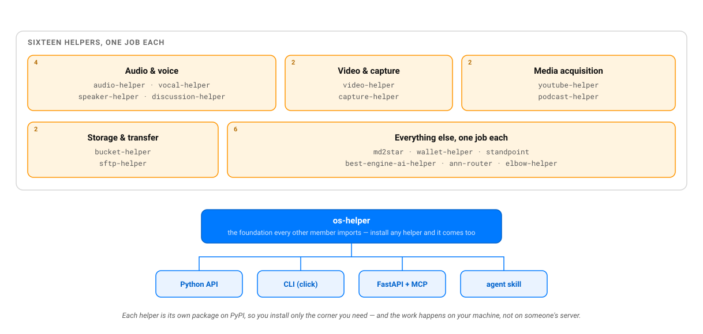

# AI Helpers

**A suite of local-first libraries for AI and media work** — one clear job each, the same shape everywhere. Python throughout, with [Rust ports](#rust-ports) for the corners that have to run where Python cannot.

## 🌍 [deraison.ai/ai-helpers](https://deraison.ai/ai-helpers/)

**The website is the home of the suite** — overview, documentation, and a positioning map for every helper. Start there.

---

## How it works



Every helper is its own package on **PyPI**, so you install only the corner you need (each pulls in `os-helper` automatically):

| Group | Helpers |
|---|---|
| 🧱 Core | `os-helper` |
| 🔊 Audio & voice | `audio-helper` · `vocal-helper` · `speaker-helper` · `discussion-helper` |
| 🎬 Video & capture | `video-helper` · `capture-helper` |
| 🌐 Media acquisition | `youtube-helper` · `podcast-helper` |
| 🗄️ Storage & transfer | `bucket-helper` · `sftp-helper` |
| 🧩 Misc | `md2star` · `wallet-helper` · `standpoint` · `best-engine-ai-helper` · `ann-router` · `elbow-helper` |

```bash
pip install audio-helper vocal-helper   # install a group
pip install os-helper                    # or just the foundation
```

Each helper exposes the **same four surfaces** — a Python API, one CLI built with click, a FastAPI HTTP server, an MCP tool set mounted on that same app, and an **agent skill** (Claude / OpenCode) — and runs **local-first**: your files, audio, camera/mic and documents are processed on your machine, with no SaaS, no telemetry, no account. (Bucket and SFTP are the honest exception — their job is to move data to storage *you* choose.)

## Rust ports

Some helpers also exist as **Rust crates**, published on [crates.io](https://crates.io/search?q=helper-rs). They are not bindings and not line-by-line translations: each is an independent rewrite of its helper's core promise, idiomatic Rust throughout, and each is verified against the Python it mirrors rather than assumed to agree.

| Crate | Mirrors | Its own promise |
|---|---|---|
| [`md2star-rs`](https://github.com/warith-harchaoui/md2star-rs) | `md2star` | Markdown → DOCX & PPTX, pure Rust: no Pandoc, no subprocess, single static binaries |
| [`audio-helper-rs`](https://github.com/warith-harchaoui/audio-helper-rs) | `audio-helper` | File-level audio utilities on top of `ffmpeg`/`ffprobe` |
| [`capture-helper-rs`](https://github.com/warith-harchaoui/capture-helper-rs) | `capture-helper` | A live microphone into a stream of PCM packets, no service in the loop |
| [`podcast-helper-rs`](https://github.com/warith-harchaoui/podcast-helper-rs) | `podcast-helper` | URL in, PCM out — any audio source to the stream a speech model expects |
| [`youtube-helper-rs`](https://github.com/warith-harchaoui/youtube-helper-rs) | `youtube-helper` | One consistent Rust interface around invoking `yt-dlp` |
| [`vocal-helper-rs`](https://github.com/warith-harchaoui/vocal-helper-rs) | `vocal-helper` | Streaming speaker diarization through an ONNX graph, no Python and no torch |

**Why Rust, stated honestly: not for speed.** It was measured on `vocal-helper-rs` rather than assumed — 99.8 % of the diarization wall time is already inside ONNX Runtime, so in C++, and the Rust crate calls the same library. The ceiling on a port's speed gain there is 0.2 %.

It is for **places to run**. On iOS and Android the Python path does not exist: one does not reasonably embed CPython and a scientific stack in a mobile application. That is an argument about possibility, not performance. Add to it one static binary per platform, no dependency resolution at install time, and no interpreter to start.

Every repo carries a root `TRIGGERS.md` — the exhaustive catalogue of what should, and should not, reach for that helper — mirrored into `skills/<helper>/references/triggers.md`. A `scripts/check_triggers.py` gate keeps each skill's `description` naming every capability and carrying an explicit SKIP clause, inside the 1024-character cap the Agent Skills standard sets, and the test suite fails when the two drift apart.

## License

BSD-3-Clause — see [LICENSE](LICENSE).
